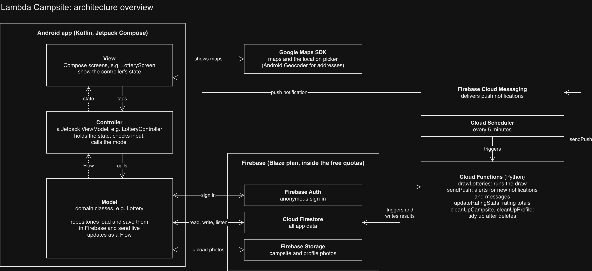
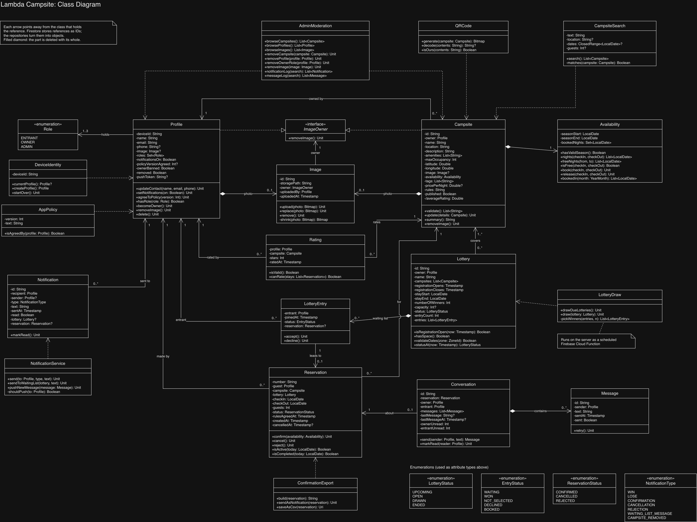
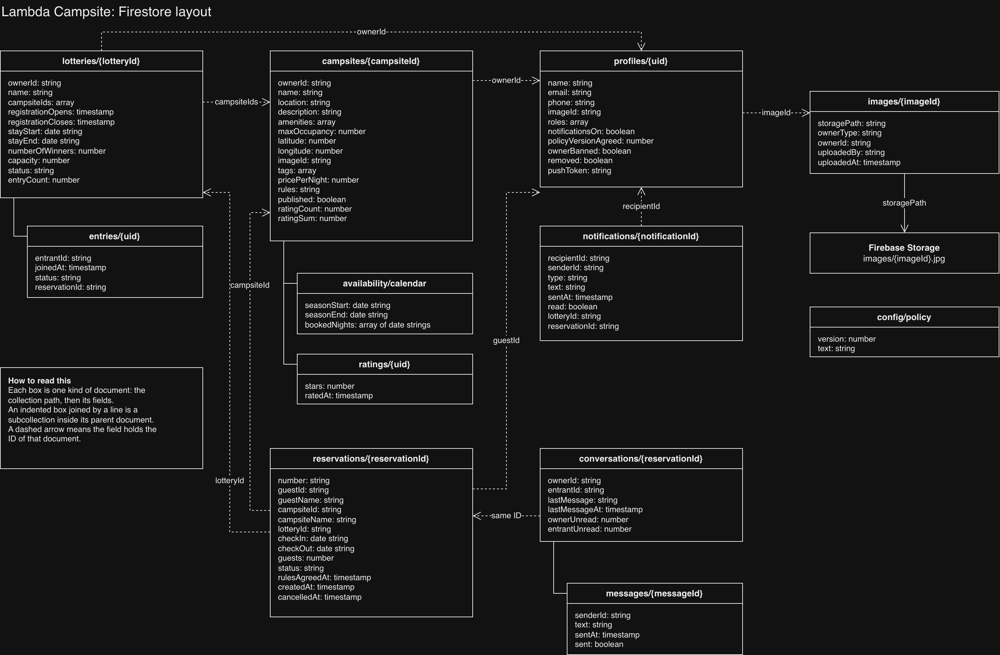
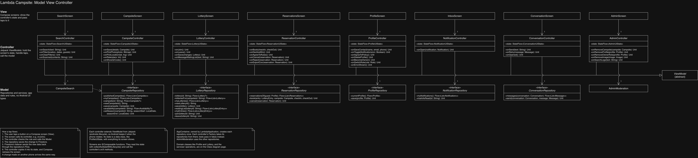
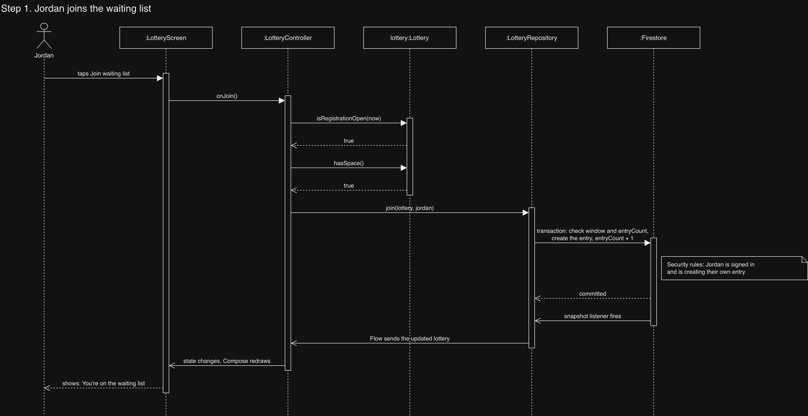
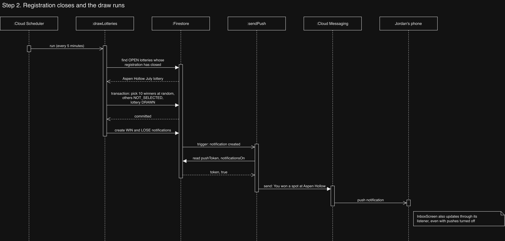
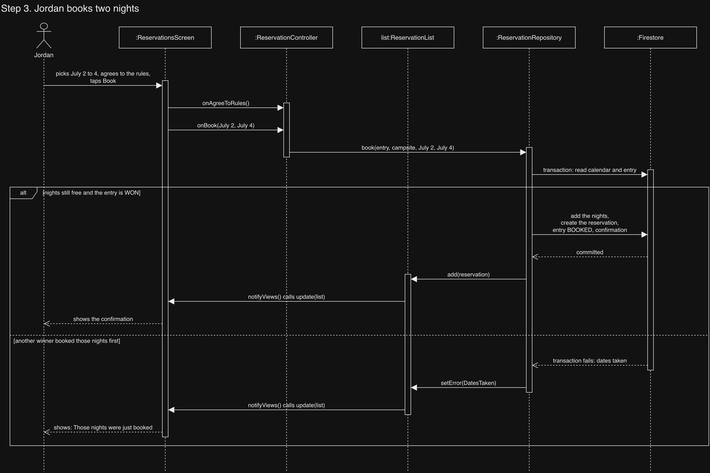

# Lambda Campsite architecture

Sashreek and Sreeman · last updated November 1, 2026

> AI use: Claude Opus 5.5 (Anthropic), used through Claude Code, helped
> write this document and its diagrams in October 2026, working from
> decisions the team made. It also checked the free-tier figures in
> section 4 against Firebase's pricing pages, and helped update sections
> 5 to 7 when we moved the controllers to Jetpack ViewModels, and helped
> update sections 5 and 7 when the profile moved to Firestore, and helped
> add the campsite repository to sections 3, 5 and 7, and helped add the
> availability calendar to sections 4, 5 and 7, and helped add lotteries
> to sections 3, 4, 5 and 7. Sashreek reviewed and edited it.

This page explains how the app is put together. It covers the class diagram and the reasons behind it, the backend on Firebase, and how the Android app splits into Model, View and Controller. Section 6 follows one entrant from tapping "Join" to holding a reservation, so you can see every layer working in one story. Section 7 is the practical part: where files live, what to name things, and how to add something to the frontend or the backend. If a term is new to you, like repository, Flow or transaction, `docs/glossary.md` explains it.

## Contents

1. [The big picture](#1-the-big-picture)
2. [From user stories to the class diagram](#2-from-user-stories-to-the-class-diagram)
3. [Design decisions and why we made them](#3-design-decisions-and-why-we-made-them)
4. [Backend on Firebase](#4-backend-on-firebase)
5. [The app: Model, View, Controller](#5-the-app-model-view-controller)
6. [One user, front to back](#6-one-user-front-to-back)
7. [Working in the codebase](#7-working-in-the-codebase)

## 1. The big picture

The app runs on the phone and talks to Firebase. Firebase holds the data and runs the server code we can't run on a phone, like the lottery draw at the moment registration closes.



| Part | What we use | Why |
|---|---|---|
| Language | Kotlin | The course examples use it. |
| UI | Jetpack Compose in one `MainActivity` | The repo's accessibility guide is written for Compose. |
| App structure | Model, View, Controller, with Jetpack `ViewModel` classes as the controllers | Android keeps a ViewModel through rotation, and Compose redraws from its state on its own. Section 5 explains it. |
| Sign-in | Firebase Auth, anonymous | Every install gets a stable user ID with no login screen, which is what US 01.09.01 asks for. |
| Database | Cloud Firestore | Live listeners, transactions and offline support. |
| Photos | Firebase Storage | Campsite and profile photos. |
| Server code | Cloud Functions in Python | The draw has to run on time even if no phone has the app open. |
| Push | Firebase Cloud Messaging | Win, lose and message alerts. |
| Maps | Google Maps SDK and Android's Geocoder | Maps on Android are free. Geocoder turns an address into a pin without the paid Places API. |
| Plan | Firebase Blaze, kept inside the free quotas | Functions need Blaze, and Storage has needed it since February 3, 2026. Section 4 lists the free quotas and our expected usage. |

## 2. From user stories to the class diagram

We read all 60 user stories, underlined the nouns and circled the verbs. Nouns became classes or attributes, verbs became responsibilities, and screen words like "button" or "dialog" were dropped. That gave 20 CRC cards (see the CRC Cards page), and the cards became the class diagram below.



### The classes

| Group | Classes | What they cover | Stories |
|---|---|---|---|
| People and roles | Profile, Role, DeviceIdentity, AppPolicy | Who the user is, which roles they hold, the policy they agreed to | 01.07.03 to 01.11.01, 03.11.01 |
| Campsites | Campsite, Availability, Rating, Image, ImageOwner, QRCode, CampsiteSearch | Listings, photos, free nights, ratings, QR codes, search | 01.01.01 to 01.01.05, 01.12.01, 01.13.01, 02.01.01 to 02.03.01 |
| Lotteries | Lottery, LotteryEntry, LotteryDraw | Registration window, waiting list, the automatic draw | 01.01.06 to 01.04.03, 02.04.01 to 02.05.01, 02.09.01 |
| Bookings | Reservation, ConfirmationExport | Confirmed stays, cancelling and rejecting, confirmations by notification or CSV | 01.04.02 to 01.07.02, 02.06.01 to 02.08.01, 02.11.01 |
| Communication | Notification, NotificationService, Conversation, Message | In-app notices, pushes, owner and entrant chat | 01.03.01, 01.03.02, 01.10.01, 02.10.01, 02.10.02, 02.12.01 |
| Admin | AdminModeration | Browsing and removing campsites, profiles and images, reading the logs | 03.01.01 to 03.12.01 |
| Enumerations | Role, LotteryStatus, EntryStatus, ReservationStatus, NotificationType | Fixed sets of values used as attribute types | |

## 3. Design decisions and why we made them

| Decision | Why |
|---|---|
| A profile holds a set of roles instead of Entrant, Owner and Admin subclasses. | One person can be an entrant and an owner at the same time (03.11.01), and an admin can take the owner role away (03.07.01). An object can't change its class while the app runs, so inheritance breaks both stories. |
| Any profile can become an owner by listing a campsite. Admins are set by hand in Firestore. | Real apps never let you make yourself an admin. Security rules stop a user from adding ADMIN to their own roles. |
| Profile has an `ownerBanned` flag. | When an admin removes an owner for breaking the policy (03.07.01), the flag stops them from listing a campsite again. |
| A removed profile stays in Firestore with `removed` set and its personal details wiped. | Identity comes from the device (01.09.01). Deleting the document would let a removed user start over on the next launch. A user who deletes their own profile (01.08.01) gets a full delete. |
| Profile and Campsite implement the `ImageOwner` interface. | One Image class serves both. When an admin removes a photo (03.03.01), the image tells its owner to fall back to a placeholder without caring which kind of owner it is. |
| Image, Availability, LotteryEntry and Message are composition parts. | None of them means anything without its whole, so deleting a campsite must delete its photo and calendar. Firestore doesn't delete a document's subcollections by itself, so the `cleanUpCampsite` and `cleanUpProfile` functions do it (section 4). |
| The diagram types references with the class, like `reservation: Reservation`. Firestore stores them as IDs. | This follows the course's rules for turning UML into Kotlin. Repositories turn IDs into objects when they load data. The exceptions are `Campsite`, `Lottery` and `LotteryEntry`, which keep `ownerId`, `campsiteIds` and `entrantId` as strings. Profiles are private, so other users can't load the owner's or entrant's profile, and a lottery's campsites load through their own repository. |
| "Booking period" in 02.04.04 means the stay dates the lottery covers. | Every reservation comes from a lottery, so each lottery has to say which nights it gives out. A campsite can run a July lottery and an August lottery. |
| No replacement draw when a winner declines (01.04.03). | The declined nights go back to the calendar for the other winners, and the draw stays a single event. |
| Price per night is optional and only displayed. Rules are one text field that includes the cancellation policy. | No story covers payment, so there are no refunds to handle. 02.11.01 needs rules that entrants agree to. |
| Only entrants with a completed stay can rate, and ratings are stars only. | It stops fake ratings, and nobody has to moderate written reviews. |
| One Notification class with a `type` field. | The admin's notification log (03.08.01) reads every notification from one place. |
| Reservations store CONFIRMED, CANCELLED or REJECTED. "Completed" is worked out from the check-out date. | Nothing has to run at midnight to change statuses. |
| A lottery is saved as OPEN and stays OPEN until it's drawn or cancelled. UPCOMING is worked out from `registrationOpens`. | Nothing has to run when registration opens to change the status, and the draw only has to look for OPEN lotteries. |
| A lottery covers at most five campsites. | The security rules check that the owner owns each campsite, and rules can't loop over a list, so each campsite gets its own check. A request can also read at most 10 documents. |
| Messaging is two-way, with one Conversation per reservation, created when the chat opens. | 02.12.01 asks for owner messages and replies are wow factor 7. A new conversation can have zero messages, so `lastMessage` and `lastMessageAt` are nullable. |
| We use the Blaze plan but stay inside the free quotas. | Cloud Functions only run on Blaze, and Cloud Storage has needed Blaze since February 3, 2026. The free quotas still apply on Blaze, and our expected usage is far below them (see section 4). |
| Controllers are Jetpack ViewModels, not the lecture's `TModel` and `TView` classes. | Android keeps a ViewModel when the phone rotates, and Compose redraws from its state by itself, so we don't write our own lists of views or code to remove them. Model, View and Controller still do the same jobs. |

## 4. Backend on Firebase

### Where the data lives

The diagram shows every collection, the fields in each document, and which fields point at other documents. The table after it explains why each collection is shaped the way it is.



| Firestore path | Holds | Why this shape |
|---|---|---|
| `profiles/{uid}` | Profile | The document ID is the Firebase Auth user ID, so the app finds a profile without a query. |
| `campsites/{campsiteId}` | Campsite, plus `ratingCount` and `ratingSum` | `averageRating` is worked out from those two numbers. |
| `campsites/{campsiteId}/availability/calendar` | Availability | A separate document, so entrants can book nights without write access to the campsite itself. |
| `campsites/{campsiteId}/ratings/{uid}` | Rating | The document ID is the rater, so rating again replaces the old rating (01.13.01). |
| `lotteries/{lotteryId}` | Lottery, plus `entryCount` | A transaction checks the waiting-list limit (02.04.07) by reading one document. |
| `lotteries/{lotteryId}/entries/{uid}` | LotteryEntry | The document ID is the entrant, so nobody can join twice. Each entry also stores `entrantId`, a copy of that ID, so one collection group query finds every waiting list a person is on. |
| `reservations/{reservationId}` | Reservation | Top level, so we can query by guest, by campsite or by status. |
| `conversations/{reservationId}` | Conversation | The document ID is the reservation, which allows only one conversation per reservation. |
| `conversations/{reservationId}/messages/{messageId}` | Message | Messages load in pages, newest first. |
| `notifications/{notificationId}` | Notification | Every type goes in one collection, which the admin log reads. |
| `images/{imageId}` | Image | The photo file itself is in Storage at `images/{imageId}.jpg`. |
| `config/policy` | AppPolicy | The policy text and its version number. |

A few conventions keep the data consistent:

- Dates without a time, like check-in or season start, are stored as strings such as `2027-07-02`. Firestore has no date-only type, and these strings sort in date order. In the app they're `LocalDate`s. `AvailabilityFields` shows how to turn them into strings and back, and `isDate()` in `firestore.rules` checks their format.
- Times like `joinedAt` and `sentAt` use Firestore server timestamps, so a phone with the wrong clock can't move ahead in the queue.
- Enums are stored by name, like `WON`.
- Lists copy a few fields to avoid extra reads. A reservation stores the guest's name and the campsite's name, so the owner's reservation list loads with one query.

### Cloud Functions

| Function | Runs when | What it does |
|---|---|---|
| `drawLotteries` | Every 5 minutes, on a schedule | Finds open lotteries whose registration has closed. For each one, a transaction picks the winners at random, marks everyone else NOT_SELECTED, sets the lottery to DRAWN and writes the WIN and LOSE notifications. The transaction checks the status first, so a lottery is never drawn twice. |
| `sendPush` | A notification or message document is created | Reads the recipient's `pushToken` and `notificationsOn`. If notifications are on, it sends the push through FCM. The in-app copy exists either way, which is what 01.10.01 needs. |
| `updateRatingStats` | A rating is written | Updates `ratingCount` and `ratingSum` on the campsite. |
| `cleanUpCampsite` | A campsite document is deleted | Deletes its `availability` and `ratings` subcollections and its photo in Storage, cancels its open lotteries and upcoming reservations, and notifies everyone affected with a CAMPSITE_REMOVED notification (03.01.01). |
| `cleanUpProfile` | A profile is deleted (01.08.01) or an admin marks it removed (03.02.01) | Removes the person's waiting-list entries, cancels their upcoming reservations and deletes their photo. If they own campsites, it deletes those too, which runs `cleanUpCampsite` for each one. |

The functions are written in Python, since Firebase's tools don't support Kotlin, and deploy with the Firebase CLI. One person should own them.

### Transactions

A Firestore transaction reads and writes several documents as one step. If another phone changes one of those documents first, Firestore runs the whole transaction again with fresh data. We use transactions in four places.

- Joining a lottery checks the registration window and the waiting-list limit, creates the entry and adds one to `entryCount`. Leaving checks the window, deletes the entry and takes one away.
- Booking checks that the nights are free and the entry is WON, adds the nights to the calendar, creates the reservation and sets the entry to BOOKED. This is what stops two winners from booking the same night, the problem in scenario 1 of the spec.
- Cancelling or rejecting a reservation sets its status and frees the nights in the same step.
- The draw, described above.

### When the phone is offline

Firestore keeps a local copy of the data each screen has loaded, so screens still show their last state without a connection. Ordinary writes, like editing a profile or marking a notification read, wait on the phone and go through when the connection comes back.

Transactions can't wait like that, because they need the server's latest data. Joining or leaving a lottery, booking, cancelling and rejecting all fail while the phone is offline, and so do photo uploads. When one fails, the controller puts an offline error in its state. The screen shows a message with a retry button, never a spinner that doesn't end.

### Security rules

The app checks every rule before it calls Firestore, so users get a quick error message. The security rules check the same things again on Google's servers, so a modified app can't skip them.

- Every request has to come from a signed-in user. Anonymous sign-in counts.
- Users can edit only their own profile. They can't add ADMIN to their roles, they can add OWNER only while `ownerBanned` is false, and they can't change `ownerBanned` or `removed`.
- Only a campsite's owner can edit the campsite or set its season. An entrant can change the availability calendar only in the same write that creates their own reservation.
- Only an owner can run a lottery, and only for campsites they own. They can edit it until it's drawn. Only Cloud Functions change its status.
- Entrants can add or remove only their own entry, only while registration is open, and only in the same write that changes `entryCount` by one. Only the lottery's owner can read its waiting list.
- Only admins can delete other people's campsites, profiles or images, set `ownerBanned`, or read every notification and message.
- Only the conversation's owner and entrant can read its messages, plus admins.
- A removed profile can't write anything.

### Staying inside the free quotas

These are the no-cost amounts on the Blaze plan, from Firebase's [pricing page](https://firebase.google.com/pricing) and [Storage FAQ](https://firebase.google.com/docs/storage/faqs-storage-changes-announced-sept-2024), checked October 30, 2026.

| Service | Free on Blaze | What we expect to use |
|---|---|---|
| Cloud Functions | 2 million calls, 400,000 GB-seconds and 5 GB of outbound data a month | The draw check runs every 5 minutes, about 8,640 calls a month, plus one call per notification, message, rating and deleted campsite or profile. |
| Cloud Firestore | 50,000 reads, 20,000 writes and 20,000 deletes a day, 1 GiB stored | Each draw check costs at least one read, about 290 a day. Six people testing stay in the low thousands. |
| Firebase Storage | 5 GB stored, 100 GB downloaded, 5,000 uploads and 50,000 downloads a month | Photos are shrunk to about 800 pixels wide before upload, around 150 KB each. |
| Cloud Scheduler | 3 jobs per account | One job, for the draw. |
| Auth and Cloud Messaging | Free, except phone sign-in | We use anonymous sign-in, not phone sign-in. |
| Artifact Registry | 500 MB of stored function images | Every deploy adds an image, so old ones need cleaning up. |

Four setup steps keep the bill at zero:

1. Create the Firestore database in the Standard edition. The quotas above are for Standard.
2. Create the Storage bucket in `us-central1`, `us-east1` or `us-west1`. Buckets in other regions don't get the free Storage quota.
3. Turn on the Firebase CLI's cleanup policy for function images, so old deploys don't pile up past 500 MB.
4. Set a spend cap on Cloud Functions in the Firebase console, along with a $1 budget alert. A budget alert only sends an email and doesn't stop any charges.

## 5. The app: Model, View, Controller



We split the app into the Model, View and Controller layers from the course's MVC lecture, but we build them from Android's own parts instead of the lecture's `TModel` and `TView` classes. Each controller is a Jetpack `ViewModel`. Android's docs call this arrangement MVVM. We keep the MVC names because the jobs are the same: the screen shows data, and the controller takes the user's taps and changes the model.

### The three layers

| Layer | What goes in it | Rule |
|---|---|---|
| Model | Plain Kotlin classes from the class diagram, like `Profile` and `Lottery`, plus repositories that load and save them in Firestore | No Android UI types, so we can unit test it without a phone. |
| View | One Compose screen per feature, like `LotteryScreen` | Shows the controller's state and passes taps to the controller. No Firestore calls and no business rules. |
| Controller | One `ViewModel` per feature, like `LotteryController` | Holds the screen's state, checks input, and calls model methods and repositories. Never draws anything. |

Calls go one way, from View to Controller to Model. Data comes back the other way. The repository sends new data to the controller through a Kotlin `Flow`, and the screen reads it from the controller's state.

### How a controller works

Each controller has one property called `state`, a `StateFlow`. Its value is a data class, like `ProfileUiState`, with everything the screen shows. That includes model objects, like the profile, and values that only matter to the screen, like the active role or an error to display. When the controller is created, it starts listening to its repositories and copies each new value into `state`.

Each user action is one `onSomething` method, like `onJoin` or `onSwitchRole`. The method checks the rule on the model, calls a repository if data has to change, and puts an error in `state` if anything says no. Calls to Firestore run in the controller's `viewModelScope`, so they never freeze the screen, and Android cancels them when the screen is gone for good.

### How a screen works

A screen is a `@Composable` function that takes its controller. It reads `state` with `collectAsStateWithLifecycle()`. Whenever `state` changes, Compose redraws the parts of the screen that use the changed values. Buttons call the controller, like `controller.onJoin()`. A screen never keeps its own copy of model data.

`collectAsStateWithLifecycle()` stops listening while the app is in the background, so nothing updates a screen nobody can see.

### Repositories and listeners

Each main model has a repository, like `CampsiteRepository` or `LotteryRepository`. Repositories belong to the Model layer. They turn Firestore documents into objects and back, run the transactions, and attach snapshot listeners.

A repository returns live data as a `Flow`, like `currentProfile()`, which returns a `Flow` of `Profile`. A Firestore snapshot listener sits behind it. When the data changes, on this phone or on another one, the listener fires, the `Flow` sends the new object, and the controller's `state` updates. That's how an owner's edit to a campsite shows up on your phone. Writes are `suspend` functions, like `save(profile)`. They return once Firestore accepts the write and throw an exception if it fails.

Each repository is an interface. The app uses a Firestore version, and unit tests use a fake, so we can test a controller without Firebase. Until a Firestore version exists, the app can use an in-memory one with sample data.

`FirestoreProfileRepository` is the one to copy for a new Firestore repository. It waits for the signed-in user with `signedInUserId()` from `model/repository/AuthFlows.kt`, listens to the document with `liveSnapshots()` from `model/repository/FirestoreFlows.kt`, and returns a `Flow`. Use `liveSnapshots()` rather than Firestore's own `snapshots()`, because when the security rules refuse a read, `snapshots()` cancels the `Flow` without an error and the screen waits forever. How the object is stored, with its field names, enums stored by name and defaults for missing fields, lives in a separate object, `ProfileFields`, so unit tests can check it without Firebase.

For lists, copy `FirestoreCampsiteRepository`. It runs queries through the `Query` version of `liveSnapshots()`. Every query has to fit the security rules, because rules don't filter results: Firestore refuses a whole query if it could return a document the user isn't allowed to read. That's why `publishedCampsites()` asks for `published == true`. Its `save` uses `SetOptions.merge()`, which keeps the fields the app doesn't write, like the rating totals a Cloud Function keeps.

When a transaction refuses for a reason the user should see, the repository throws an exception that names the reason. `LotteryRepository.join` throws a `WaitingListException` with a reason like `FULL` or `REGISTRATION_CLOSED`, so the controller can show the right message. Other failures, like being offline, stay a `FirebaseFirestoreException`.

A document that belongs to another one can share its parent's repository. A campsite's calendar is `campsites/{id}/availability/calendar`, so `availability()` and `setSeason()` are on `CampsiteRepository` instead of a repository of their own. `setSeason` is a merge write with only the season fields, so it keeps the booked nights.

### Wiring it together

- `LambdaApplication` creates one `AppContainer` when the app starts. The container creates each repository once, and it's the only place that decides which version the app uses. Moving from in-memory to Firestore repositories is a change to `AppContainer` alone.
- Each controller has a `Factory` that takes its repositories from the container. A screen's route gets its controller with `viewModel(factory = XController.Factory)`. Android hands back the same controller after the phone rotates, so the screen shows its data straight away without reloading from Firestore.
- `MainActivity` only applies the theme and shows `LambdaCampsiteApp`. That function, in `view/`, holds Compose navigation, the top bar and the bottom nav bar for the active role, whether Entrant, Owner or Admin. `AppTab` lists every tab and which roles see it.
- Slow work, like shrinking a photo before upload or building a CSV file, runs on a background thread inside the controller's `viewModelScope`, so the screen stays responsive.

### Features

| Screen | Controller | Model it calls | Stories |
|---|---|---|---|
| SearchScreen | SearchController | CampsiteSearch | 01.01.01 to 01.01.04, 01.12.01 |
| CampsiteScreen | CampsiteController | CampsiteRepository | 01.01.05, 01.13.01, 02.01.01 to 02.03.01 |
| LotteryScreen | LotteryController | LotteryRepository | 01.01.06 to 01.02.02, 02.04.01 to 02.05.01, 02.09.01, 02.10.01 |
| ReservationsScreen | ReservationController | ReservationRepository | 01.04.01 to 01.07.02, 02.06.01 to 02.08.01, 02.11.01 |
| ProfileScreen | ProfileController | ProfileRepository | 01.07.03 to 01.11.01, 03.11.01 |
| InboxScreen | NotificationController | NotificationRepository | 01.03.01, 01.03.02, 02.10.02 |
| ConversationScreen | ConversationController | ConversationRepository | 02.12.01 |
| AdminScreen | AdminController | AdminModeration | 03.01.01 to 03.12.01 |

`CampsiteSearch` and `AdminModeration` are services from the class diagram, and they call the repositories themselves.

The starter code already has the profile feature: `ProfileScreen`, `ProfileController`, `ProfileRepository` and their tests. Copy its shape when you build a new feature.

## 6. One user, front to back

Jordan Lee, an entrant, wants a weekend at Aspen Hollow Campsite. The owner runs a lottery that covers July 1 to 31, 2027, gives out 10 winning spots and closes registration on June 1.

### Step 1. Jordan joins the waiting list



On the phone, the screen only passes the tap along. The controller asks the Lottery model first, so if registration has closed, Jordan sees an error straight away with no network call.

On the backend, the transaction checks the window and the limit again. If two people take the last spot at the same moment, one transaction wins and the other runs again, finds the list full and fails. The listener then sends the updated lottery through the repository's `Flow`, and the controller's state changes. The same listener refreshes the owner's waiting list (02.09.01) if they have it open.

### Step 2. Registration closes and the draw runs



No phone takes part in the draw. It runs on the server within 5 minutes of registration closing, which is how 02.05.01 gets an automatic draw. Jordan's app only finds out through the push and the inbox listener.

### Step 3. Jordan books two nights



This is the double-booking case from scenario 1 of the spec. The calendar check and the booking happen in one transaction, so two winners can't both get July 2. A failed transaction comes back to the controller as an exception. The controller puts the error in its state, so the screen shows it the same way it shows anything else.

Across the three steps, the screens never touched Firestore and the controllers never drew anything. Every rule was checked twice, once in the model for a fast message and once in a transaction or security rule so it can't be skipped.

## 7. Working in the codebase

### Folder layout

The repo has one Android app module, the Cloud Functions, the Firebase config files and the team docs. Everything in the app lives under the `com.lambda.campsite` package.

```text
lambda-campsites/
├── app/                                 the Android app
│   ├── google-services.json             connects the app to our Firebase project
│   └── src/
│       ├── main/
│       │   ├── java/com/lambda/campsite/
│       │   │   ├── LambdaApplication.kt     starts the app and creates the AppContainer
│       │   │   ├── AppContainer.kt          creates every repository once
│       │   │   ├── MainActivity.kt          applies the theme and shows LambdaCampsiteApp
│       │   │   ├── model/                   the classes from the class diagram
│       │   │   │   └── repository/          repository interfaces and their Firestore versions
│       │   │   ├── controller/              one ViewModel per feature, with its UiState
│       │   │   └── view/
│       │   │       ├── LambdaCampsiteApp.kt navigation, the top bar and the bottom nav bar
│       │   │       ├── AppTab.kt            the nav bar tabs and which roles see them
│       │   │       ├── screens/             one screen per feature
│       │   │       ├── components/          shared pieces from Figma: field, date picker, campsite card
│       │   │       └── theme/               colours, text styles and shapes from the Figma tokens
│       │   ├── res/                         strings, icons and launcher images
│       │   └── AndroidManifest.xml
│       ├── test/                            unit tests: model rules, controllers with fake repositories
│       │   └── .../testutil/                MainDispatcherRule, which every controller test uses
│       └── androidTest/                     UI tests that run on an emulator or a phone
├── functions/                           Cloud Functions in Python
│   ├── main.py                          drawLotteries, sendPush, updateRatingStats, cleanUpCampsite, cleanUpProfile
│   └── requirements.txt
├── firestore.rules                      Firestore security rules
├── firestore.indexes.json               indexes for queries that filter on more than one field
├── storage.rules                        Storage security rules
├── firebase.json                        settings for the Firebase CLI
└── docs/                                CONTRIBUTING and the architecture, testing, documentation and accessibility guides
```

The folders follow the MVC layers, so a feature touches the same four places every time: `model`, `model/repository`, `controller` and `view/screens`.

### Naming

| Kind | Name pattern | Folder | Example |
|---|---|---|---|
| Domain class | The name from the class diagram | `model` | `Lottery` |
| Repository interface | `XRepository` | `model/repository` | `LotteryRepository` |
| Firestore repository | `FirestoreXRepository` | `model/repository` | `FirestoreLotteryRepository` |
| Conversion between an object and its Firestore fields | `XFields`, an object with `toMap` and `fromMap` | `model/repository` | `ProfileFields` |
| In-memory repository with sample data, until the Firestore one exists | `InMemoryXRepository` | `model/repository` | `InMemoryLotteryRepository` |
| Fake repository for tests | `FakeXRepository` | `test` | `FakeLotteryRepository` |
| Controller | `XController`, a `ViewModel` with one `onSomething` method per user action | `controller` | `LotteryController.onJoin` |
| Controller state | `XUiState`, a data class in the controller's file | `controller` | `LotteryUiState` |
| Screen | `XScreen`, a `@Composable` function | `view/screens` | `LotteryScreen` |
| Shared component | What it shows | `view/components` | `CampsiteCard` |
| Unit test | The class under test plus `Test` | `test` | `LotteryControllerTest` |

Class names match the class diagram exactly. If you need a new class or attribute, add it to the diagram in the same pull request.

### Adding something to the frontend

The frontend is everything in `controller` and `view`, plus the models the screens show.

#### A new screen

Example: the owner's calendar of booked dates (02.06.01).

1. Pick the model the screen shows. Reuse one if it exists. This screen shows a campsite's `Availability`. If you need a new model class, add it to `model` and to the class diagram.
2. Add `BookedDatesController` in `controller`. It extends `ViewModel`, takes its repositories in its constructor, and has a `Factory` that gets them from `AppContainer`. `ProfileController` shows the shape to copy.
3. In the same file, add `BookedDatesUiState`, a data class with everything the screen shows. The controller keeps it in `state` and has one method per thing the user can do, like `onNextMonth` and `onPreviousMonth`.
4. Create `BookedDatesScreen` in `view/screens`. It takes the controller, reads `state` with `collectAsStateWithLifecycle()`, draws the screen from shared components and calls the controller from buttons. All of its text goes in `strings.xml`.
5. Add the route in `LambdaCampsiteApp`, and a tab in `AppTab` if the screen needs one. The route gets the controller with `viewModel(factory = BookedDatesController.Factory)`.
6. Match the story's Figma mockup, and check `docs/accessibility.md` for labels and touch targets.
7. Write a unit test for the controller with a fake repository and `MainDispatcherRule`. Add a UI test in `androidTest` if the screen is part of a main flow like joining or booking.

#### A new action on an existing screen

Example: leaving a waiting list (01.02.02).

1. Put the rule in the model. `Lottery` decides whether leaving is still allowed, which is only before registration closes.
2. Add `onLeave` to `LotteryController`. It checks the rule, calls the repository, and puts an error in `state` if either one says no.
3. Add the button to `LotteryScreen` and have it call `onLeave`.
4. If the action changes data, add the repository method first. The backend guide below covers that.
5. Add a controller test for both cases, allowed and too late.

#### A new shared component

Example: the star row used on campsite cards and the details screen.

Shared components live in `view/components` and match a component in the Figma file. They take plain values and callbacks, like a number of stars and a "tapped" callback, and never a model or controller. That keeps them reusable on any screen. Colours and text styles come from `view/theme`, never typed in by hand.

### Adding something to the backend

The backend is Firestore, Storage, the security rules and the Cloud Functions. The app reaches it only through repositories.

#### A new field on an existing document

Example: `pricePerNight` on campsites.

1. Add the attribute to the domain class and to the class diagram.
2. Update the Firestore repository so it reads and writes the field. Documents saved before the change won't have it, so treat a missing value as empty.
3. Update `firestore.rules`: who can write the field and what values are allowed. Here, only the owner, and only a number of zero or more.
4. Add the field to the Firestore layout diagram and the table in section 4.

#### A new collection or subcollection

Example: how `notifications` was set up.

1. Choose the path and what the document ID should be. Use a meaningful ID when it enforces a rule. Ratings use the rater's `{uid}`, so each person can only have one rating per campsite.
2. Add the domain class, a repository interface, its Firestore version and a fake for tests. Create the Firestore version in `AppContainer`.
3. Add rules for the new path. Firestore denies everything by default, so allow exactly who can read and who can write.
4. If a query filters or sorts on more than one field, add its index to `firestore.indexes.json`.
5. If the new documents belong to a campsite or a profile, make `cleanUpCampsite` or `cleanUpProfile` delete them too. Firestore won't.
6. Add the collection to the Firestore layout diagram and the table in section 4.

#### A new Cloud Function

Example: `updateRatingStats`.

Use a Cloud Function only when the work can't happen on a phone. It has to run on a schedule with no phone open, like the draw. It has to be trusted, like picking winners, which no phone should do. Or it needs server access, like sending a push.

1. Add the function to `functions/main.py` with its trigger: a schedule, or a document being created or written.
2. Make it safe to run twice. Firebase can deliver the same trigger more than once, so check the current state before changing anything, the way the draw checks the lottery's status.
3. Test it locally with the Firebase Emulator Suite before deploying.
4. The person who owns deploys runs the deploy after the pull request is merged.
5. Add the function to the Cloud Functions table in section 4.

#### Changing security rules

Change `firestore.rules` or `storage.rules` in the same pull request as the feature that needs it. Test the change against the emulator, since a wrong rule either blocks the app or lets anyone write. The deploy owner deploys the rules along with the app's release. For a document under a campsite, like its calendar, `ownsCampsite(campsiteId)` checks that the signed-in user owns the campsite and isn't banned or removed. When two documents have to change together, like a waiting-list entry and the lottery's `entryCount`, give each one a rule that checks the other with `getAfter()` or `existsAfter()`. Those see the other writes in the same request. The lottery rules show how.

### When a story needs both

Most stories touch both sides. Do the backend part first, so the frontend has a repository method to call. Then build the screen and controller on top of it, and ship both in one pull request.
